<div align="center">

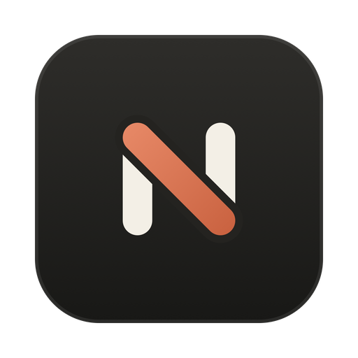

# Neurix

**Your AI. Your computer or phone. No cloud. No subscription. No limits.**

Run language models directly on your own machine, fully offline and completely private.
One app for the desktop and for Android.

[](https://github.com/Razee4315/neurix/releases)
[](https://github.com/Razee4315/neurix/actions)
[](LICENSE)
[](https://tauri.app)

**Windows** · **Android** · macOS and Linux from source

<br />

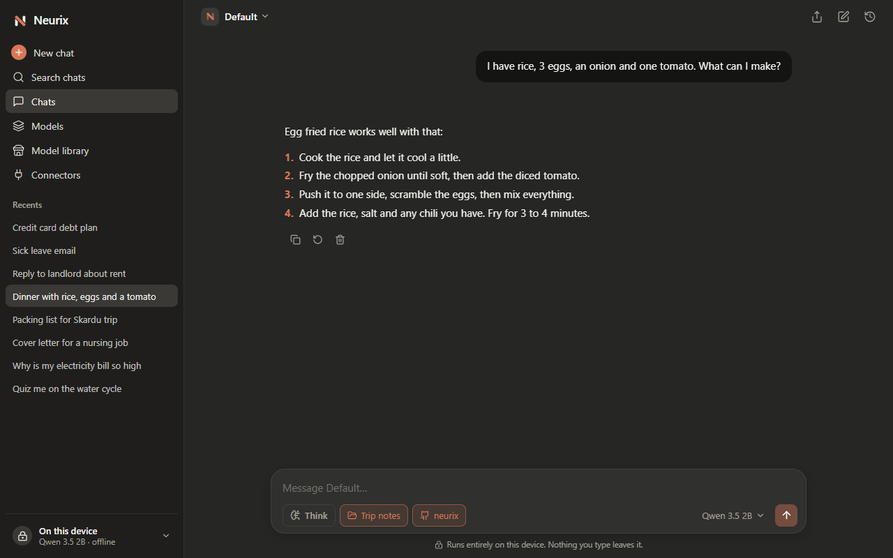

</div>

---

## The Story Behind Neurix

I'm from Skardu, a small town in the mountains of northern Pakistan. It's one of the most beautiful places on earth, surrounded by peaks, glaciers, and valleys that stretch for miles.

It's also a place where internet is a luxury, not a given.

When you drive out toward Deosai or up the road to Shigar, the signal drops. Sometimes for hours, sometimes for days. If you're trekking to a base camp or traveling through one of the many valleys, there is no connectivity at all. No cellular data, no Wi-Fi, nothing.

I relied on ChatGPT and Claude for everything: writing, coding, brainstorming, translating. But every time I left town, I lost access to all of it. And it's not just Skardu. Millions of people across remote regions, in the mountains, in rural areas, in places where infrastructure hasn't caught up, face the same problem. You're cut off from the tools that have become essential to how we work and think.

That's why I built Neurix.

Download a model once over Wi-Fi. Use it forever. On a laptop in a guesthouse with no connection, on a bus through the Karakoram Highway, in a village with no cell tower, on a flight, or just somewhere you'd rather not send your conversations to someone else's server.

No account. No subscription. No data leaving your device. Just you and your AI.

---

## What It Does

Neurix runs large language models entirely on your computer or phone. No server, no API calls, no internet required after the initial model download.

- Open the app, pick a model from the store, download it
- The model runs locally on your machine's CPU
- Chat with it like any AI assistant; it just happens to be running on your own hardware

The same app runs on the desktop and on Android. On a wide window you get a side rail for navigation and a centered reading column; on a phone you get a bottom tab bar.

---

## Screenshots

### Desktop

<div align="center">
<table>
<tr>
<td align="center">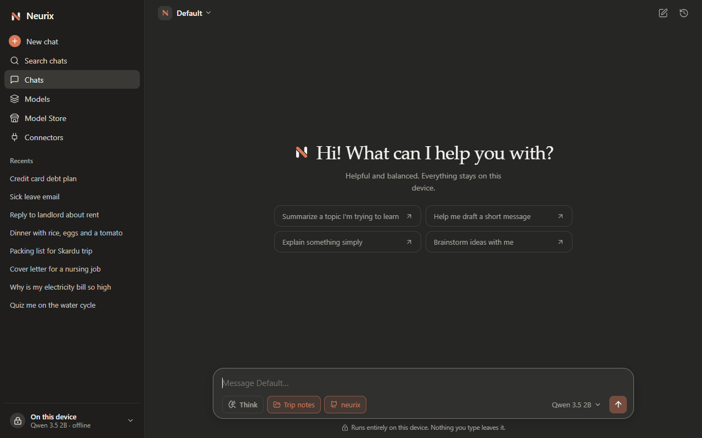<br /><b>New chat</b></td>
<td align="center">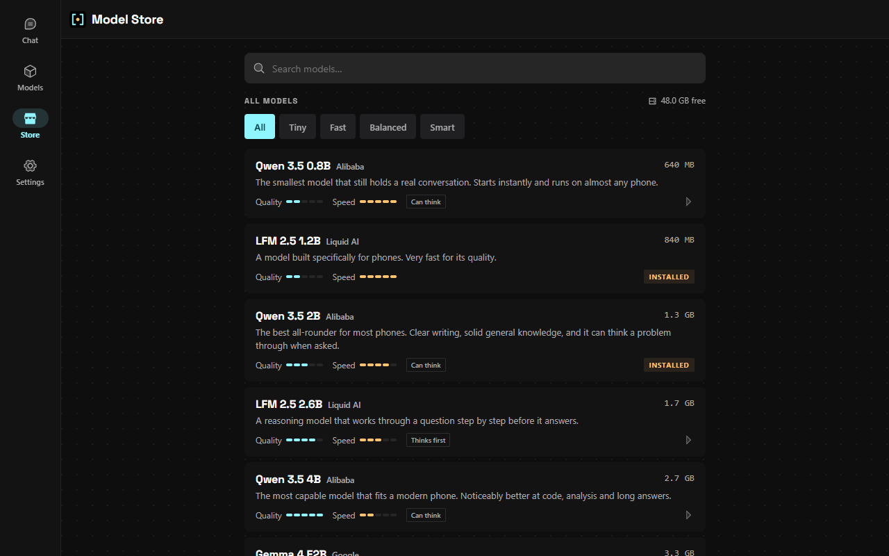<br /><b>Model Store</b></td>
</tr>
<tr>
<td align="center">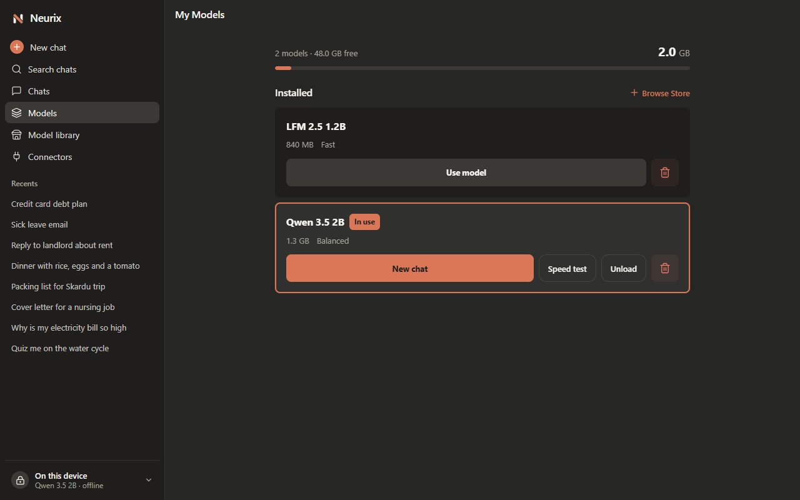<br /><b>My Models</b></td>
<td align="center">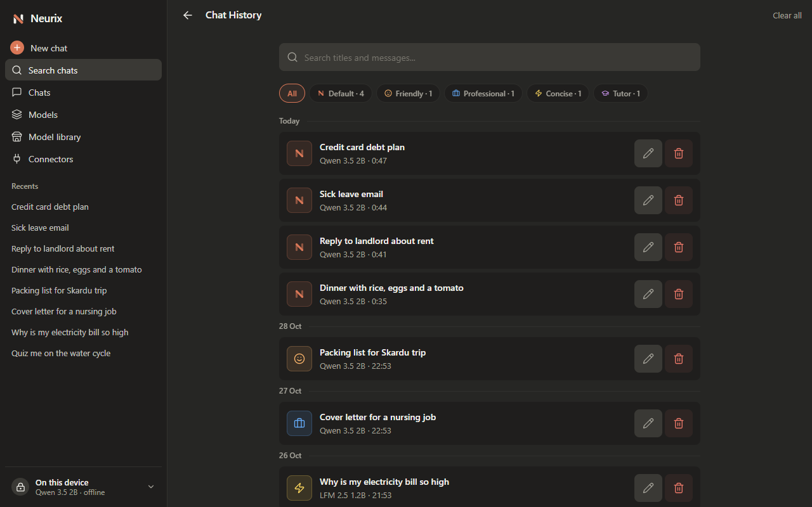<br /><b>Chat History</b></td>
</tr>
<tr>
<td align="center">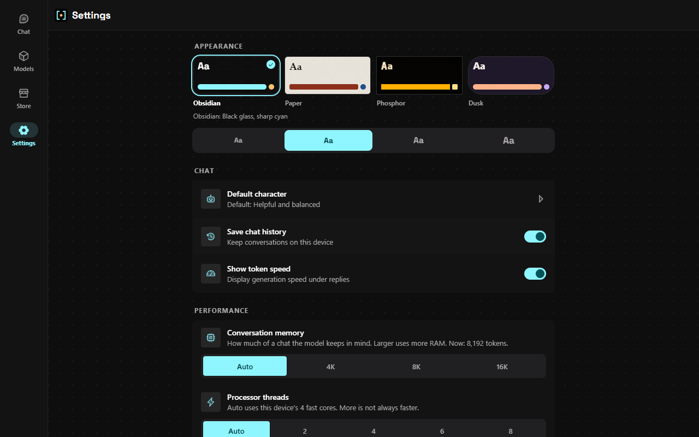<br /><b>Settings</b></td>
<td align="center">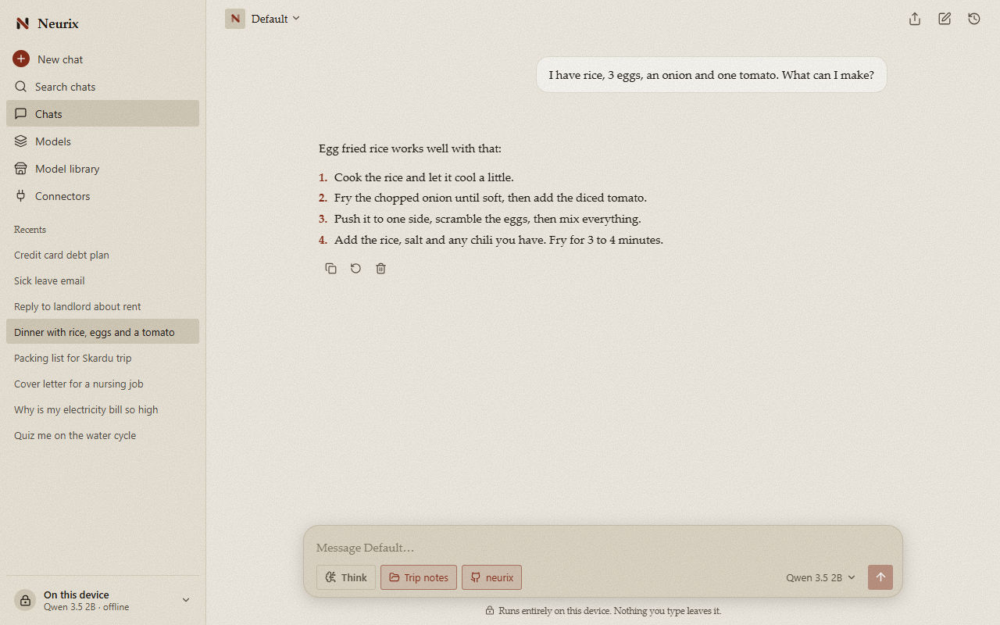<br /><b>Paper theme</b></td>
</tr>
</table>
</div>

### Android

<div align="center">
<table>
<tr>
<td align="center">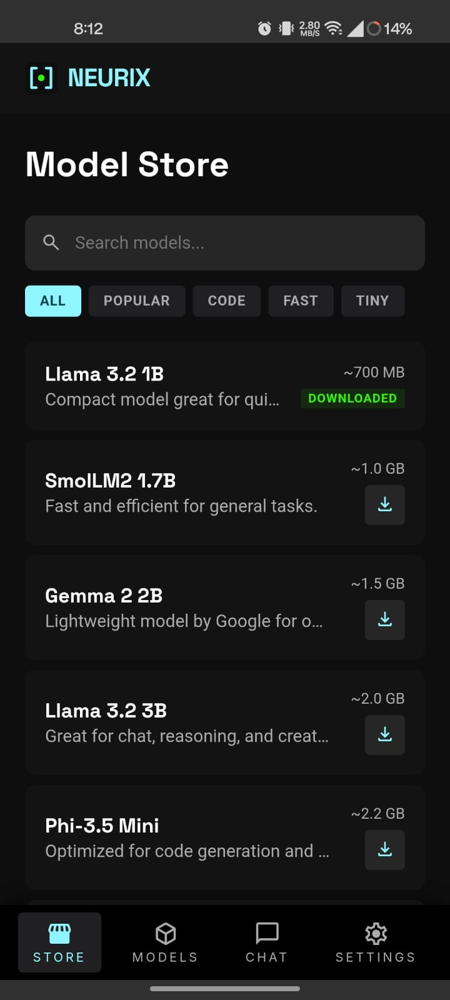<br /><b>Model Store</b></td>
<td align="center">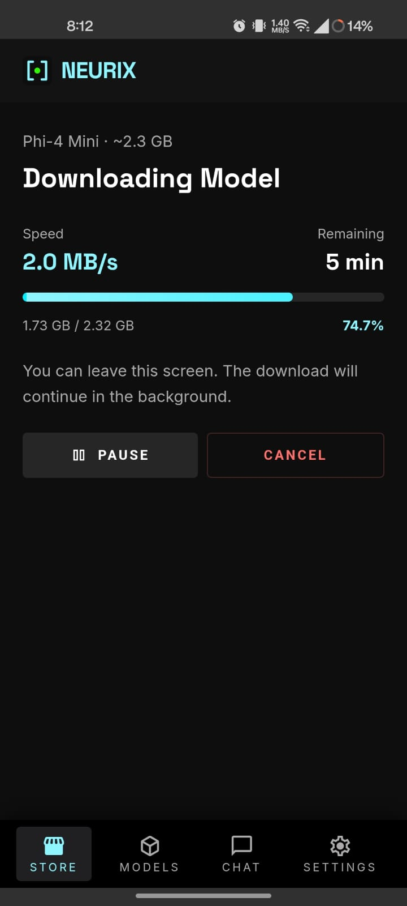<br /><b>Downloading</b></td>
<td align="center">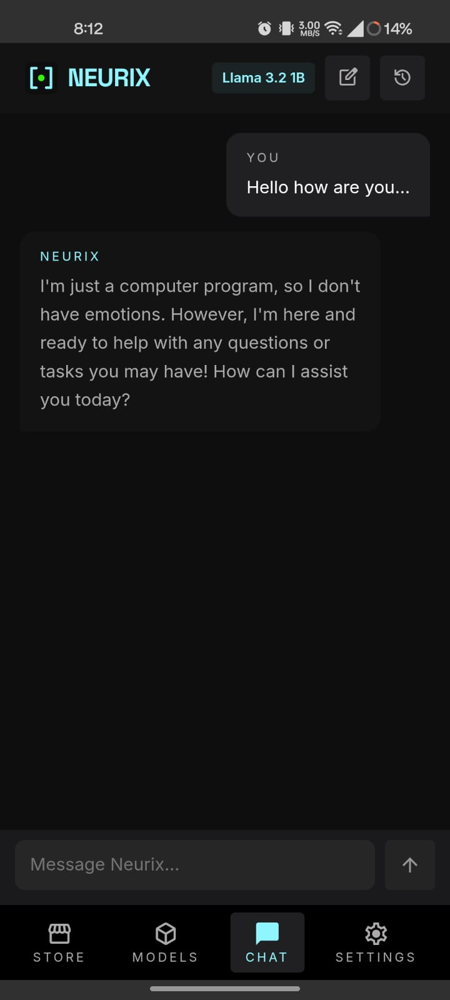<br /><b>Chat</b></td>
</tr>
<tr>
<td align="center">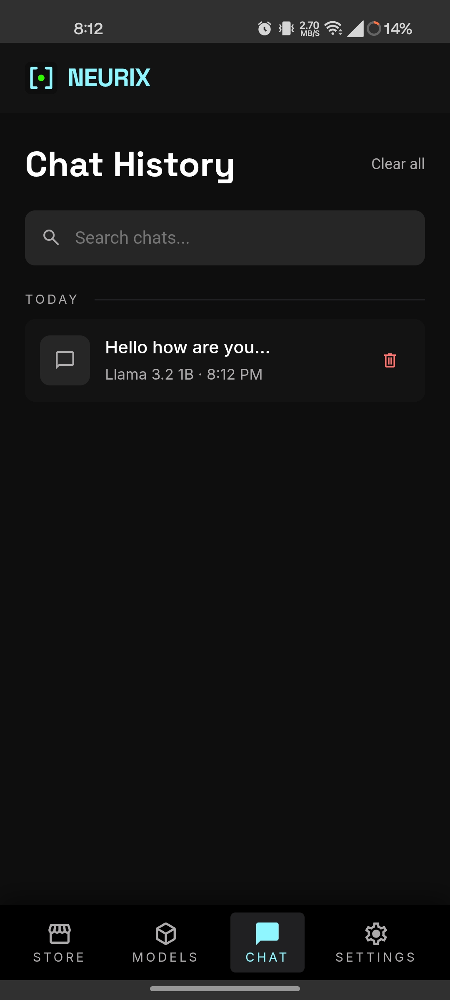<br /><b>Chat History</b></td>
<td align="center">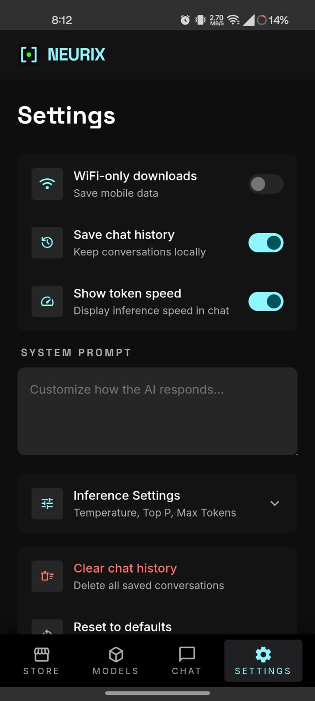<br /><b>Settings</b></td>
<td align="center">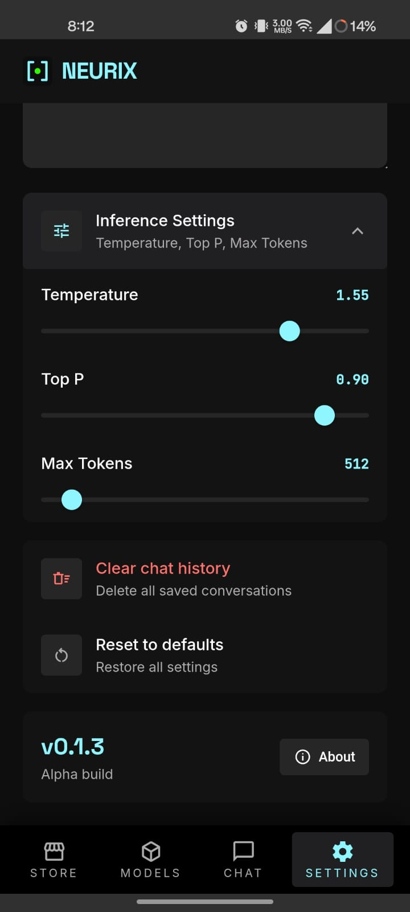<br /><b>Inference Settings</b></td>
</tr>
</table>
</div>

> The Android screenshots predate the current interface and will be refreshed.

---

## Features

- **On-device inference**: AI runs on your CPU through llama.cpp, no server involved
- **Desktop and mobile**: one codebase, native installers for Windows and Android
- **Current small models**: Qwen 3.5, LFM 2.5 and Gemma 4, from 640 MB to 5.2 GB
- **A pick for your machine**: the store suggests a model from your device's memory and warns when one will not fit
- **Reasoning models**: optional "Think" mode, with the model's reasoning shown separately from its answer
- **Fast follow-ups**: the conversation stays in the model's memory, so a reply starts without re-reading the whole chat
- **Offline after download**: use anywhere, anytime, no internet needed
- **Private by design**: conversations never leave your device
- **Model manager**: download, switch, unload and delete models; warns when a model is too large for the device
- **Chat history**: auto-saved locally, searchable by title and message text
- **Characters**: built-in and custom personas, each with its own instructions, creativity, word variety and reply length
- **Themes**: four, each with its own typeface, shapes, texture and icon style: Obsidian (black glass, sharp cyan), Paper (serif ink on warm stock), Phosphor (amber terminal) and Dusk (soft and rounded). Four text sizes
- **Resume downloads**: pause and continue where you left off; every download is checked against a SHA-256 checksum. On Android a download keeps going while the app is in the background
- **Speed test**: measure tokens per second for any model on your own machine
- **Backup**: export chats and custom characters to a file and import them on another device, including from phone to desktop and back
- **Built with Rust**: lightweight, fast, minimal memory footprint

---

## Available Models

| Model | Download | Memory | Notes |
|-------|----------|--------|-------|
| Qwen 3.5 0.8B | 640 MB | 3 GB | Smallest; quick answers on almost any device |
| LFM 2.5 1.2B | 840 MB | 3 GB | Built for phones; very fast |
| Qwen 3.5 2B | 1.3 GB | 4 GB | Best all-rounder; can reason on request |
| LFM 2.5 2.6B | 1.7 GB | 6 GB | Always reasons step by step before answering |
| Qwen 3.5 4B | 2.7 GB | 8 GB | Strongest for code and analysis on a phone |
| Gemma 4 E2B | 3.3 GB | 8 GB | Google's on-device model, official QAT build |
| Gemma 4 E4B | 5.2 GB | 12 GB | For computers and high-memory phones |

On a desktop or laptop with 16 GB of RAM every model in the catalog fits.

The catalog lives in [`src-tauri/src/models/catalog.rs`](src-tauri/src/models/catalog.rs).
Models from earlier versions (Llama 3.2, Qwen 2.5, Gemma 2, Phi-3.5, SmolLM2)
keep working if you already have them, but are no longer offered.

Any GGUF that llama.cpp supports can be added: the tokenizer and prompt
format are read from the model file itself.

---

## Installation

### Windows

1. Download the `.msi` (recommended) or the `.exe` installer from [Releases](https://github.com/Razee4315/neurix/releases)
2. Run it and open Neurix from the Start menu
3. Download a model from the store and start chatting

Windows 10 or 11, 64-bit. The installer sets up the Microsoft WebView2 runtime if it is missing.

### Android

1. Download the `.apk` from [Releases](https://github.com/Razee4315/neurix/releases)
2. Enable **Install unknown apps** in your Android settings
3. Tap the APK to install
4. Open Neurix, download a model, and you're set

Android 9 or later.

### macOS and Linux

There are no prebuilt installers for these yet. The app is plain Tauri 2 and
can be built from source with `npx tauri build` (see below), but those builds
are not tested in CI yet.

---

## Development

### Prerequisites

- Node.js 18+
- Rust 1.77+
- Tauri CLI v2
- The [Tauri system dependencies](https://tauri.app/start/prerequisites/) for your OS (WebView2 on Windows, WebKitGTK on Linux, Xcode tools on macOS)
- Android SDK + NDK (for Android builds only)

### Run the desktop app

```bash
git clone https://github.com/Razee4315/neurix.git
cd neurix
npm install
npx tauri dev
```

### Run on Android

```bash
npm run android:init    # First time only
npm run tauri:android   # Run on device/emulator
```

### Build

```bash
npx tauri build             # Desktop installer for the OS you build on
npm run build:android       # Android APK/AAB
```

Release builds for Windows and Android are made by GitHub Actions
([`release.yml`](.github/workflows/release.yml)) when a version tag is pushed.

### Commands

| Command | Description |
|---------|-------------|
| `npm run dev` | UI in a browser, against a mock backend |
| `npx tauri dev` | Desktop app (dev mode) |
| `npm run tauri:android` | Android dev |
| `npm run build:android` | Android release build |
| `npm run lint` | Biome lint |
| `npm run typecheck` | TypeScript check |
| `npm run format` | Biome format |
| `npm test` | Run unit tests once (`npm run test:watch` to watch) |

`npm run dev` on its own opens the UI in a browser against an in-memory
stand-in for the Rust backend (`src/dev/mockTauri.ts`), which is handy for
working on screens without building the native app. Resize the window to see
both the desktop and the phone layout. The mock is never bundled in production
builds.

---

## Tech Stack

| Layer | Technology |
|-------|-----------|
| Framework | [Tauri 2.0](https://tauri.app) (desktop and mobile) |
| Backend | Rust + [llama.cpp](https://github.com/ggml-org/llama.cpp) (via [llama-cpp-2](https://github.com/utilityai/llama-cpp-rs)) |
| Frontend | React 18 + TypeScript |
| Styling | styled-components |
| Inference | GGUF quantized models |
| Build | Vite |

Neurix is one of the first apps built with Tauri 2.0's mobile support, and the
same Rust and React code ships as a desktop app. The Rust backend runs models
with llama.cpp, while the React frontend provides the UI. It uses the system
WebView (WebView2 on Windows, Android System WebView on Android) instead of
bundling a browser, so the Android install is about 15 MB before models.
See [docs/ARCHITECTURE.md](docs/ARCHITECTURE.md) for how the pieces fit.

---

## Contributing

Contributions are welcome. See [CONTRIBUTING.md](CONTRIBUTING.md) for guidelines.

## Security

See [SECURITY.md](SECURITY.md) for our security policy and how to report vulnerabilities.

## License

MIT License. See [LICENSE](LICENSE) for details.

---

<div align="center">

Built by [Saqlain Abbas](https://github.com/Razee4315)

</div>
