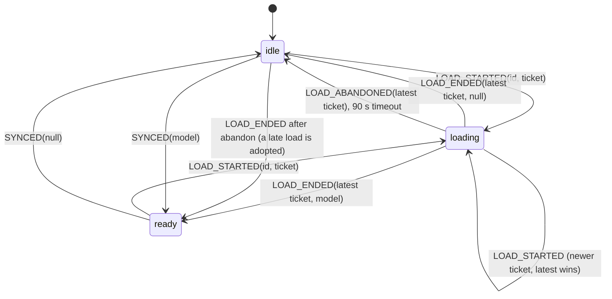
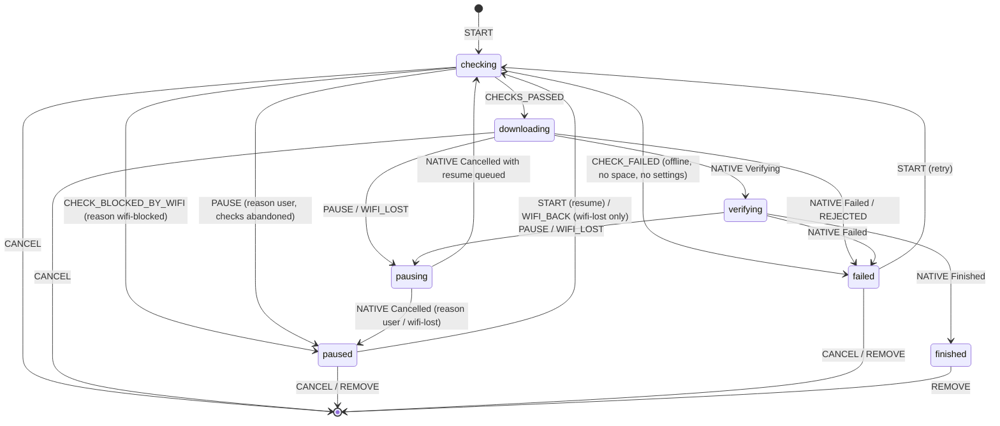
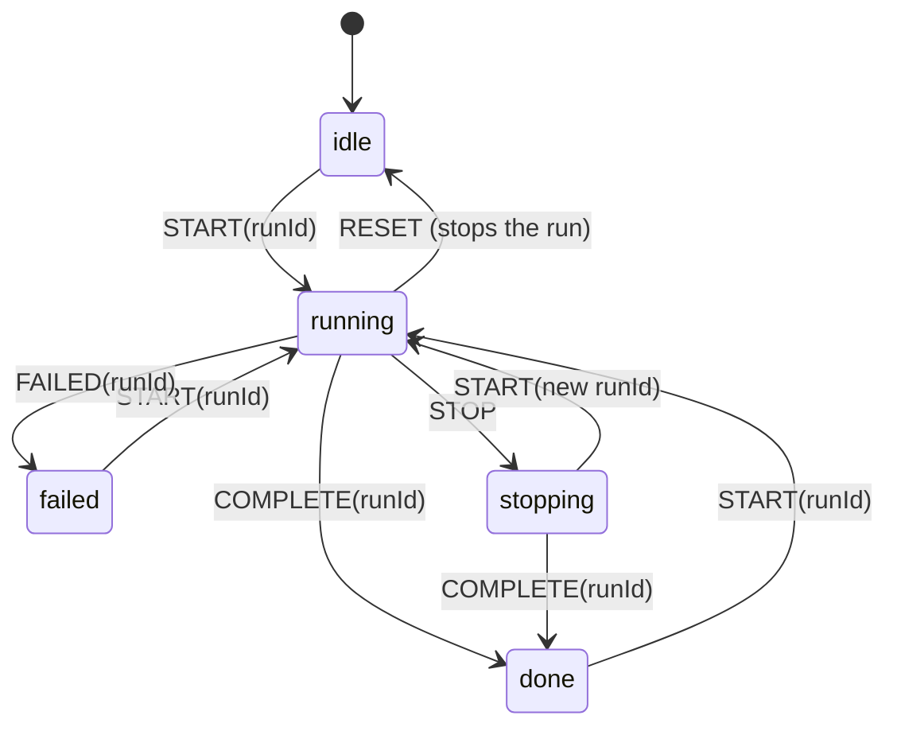
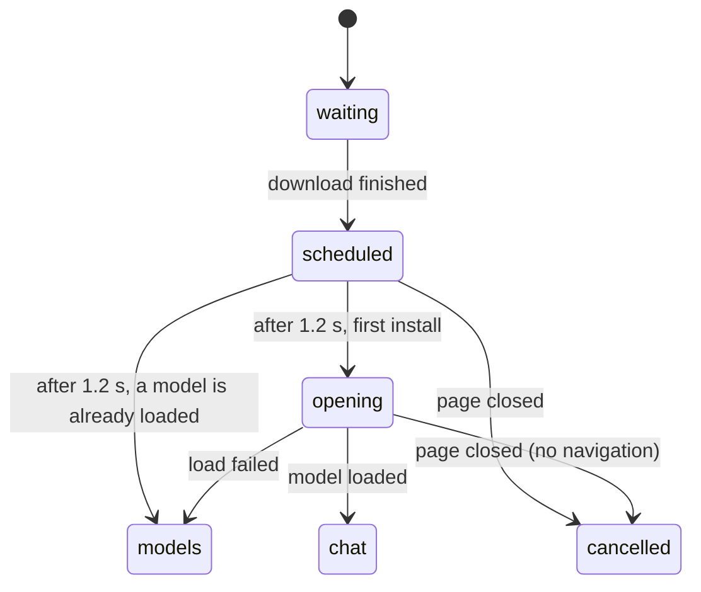
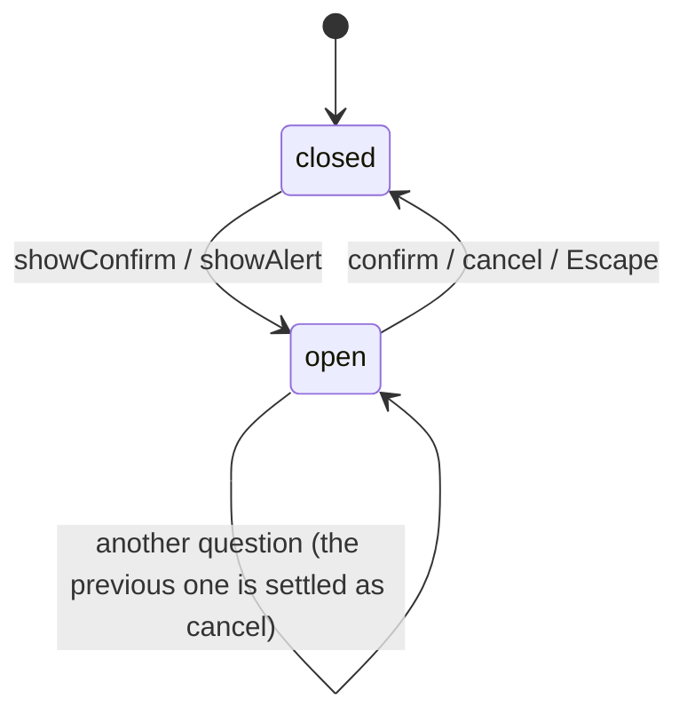
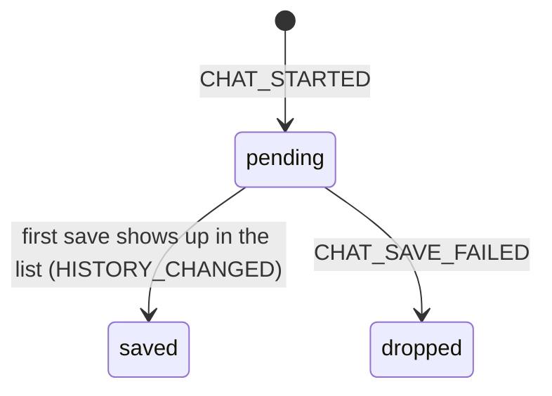

# State machines

Every flow in Neurix that moves through states is listed here: where it
lives, its states, what moves it, and what it guarantees. Read this before
changing any of them. The rules for adding a new one are in
[AGENTS.md](AGENTS.md#state-logic).

**Conventions.** States are a tagged union with a `kind` field (Rust: an
`enum`). Events are actions named in `SCREAMING_SNAKE_CASE`. Each reducer
is a pure function in its own `.ts` file, with a `.test.ts` beside it. A
reducer returns the *same object* when an action does not apply, so
callers can tell "ignored" from "changed" and React skips the re-render.
Anything asynchronous carries an id (`attempt`, `runId`, `ticket`), and
results tagged with an id that is no longer current are dropped.

| ID | Machine | Pure logic | Driven by | Tests |
|----|---------|------------|-----------|-------|
| M1 | Model in memory (backend) | `src-tauri/src/model_slot.rs` | `commands/model_cmds.rs`, `commands/chat_cmds.rs` | `model_slot.rs` (`#[cfg(test)]`) |
| M1 | Model status (front end) | `src/context/modelMachine.ts` | `src/context/AppContext.tsx` | `modelMachine.test.ts` |
| M2 | Model download | `src/context/downloadMachine.ts` | `src/context/DownloadContext.tsx` | `downloadMachine.test.ts` |
| M3 | Chat turn + message queue | `src/pages/chat/turn.ts` | `src/pages/ChatPage.tsx` | `turn.test.ts` |
| M4 | Test reply ("Try it" / "Say hi") | `src/utils/useTestRun.ts` | `CharacterEditPage.tsx`, `FriendEditPage.tsx` | `useTestRun.test.ts` |
| M5 | Download hand-off | `src/utils/downloadHandoff.ts` | `src/pages/DownloadingPage.tsx` | `downloadHandoff.test.ts` |
| M7 | Confirm dialog | `src/components/ui/dialogState.ts` | `src/components/ui/ConfirmDialog.tsx` | `dialogState.test.ts` |
| M8 | Sidebar recent chats | `src/components/layout/recents.ts` | `src/components/layout/Sidebar.tsx` | `recents.test.ts` |

(M6 was folded into M3: the connector fetches' timeouts.)

---

## M1: Model in memory

One model at a time is held in memory. The backend owns the truth; the
front end mirrors it, and adds the one state the backend does not keep:
*loading*.

```mermaid
stateDiagram-v2
  [*] --> Empty
  Empty --> Ready: set_ready (load finished)
  Ready --> Ready: set_ready (switch; old model returned to be freed)
  Ready --> InUse: checkout(ticket), reply starts
  InUse --> Ready: checkin(same ticket)
  InUse --> InUse: checkin(other ticket), stale copy dropped
  InUse --> Empty: lost(ticket), reply task panicked
  Ready --> Empty: clear (unload / delete / before a load)
  InUse --> Empty: clear (cancels the reply)
```

### Backend: `ModelSlot<M>` and `ModelOps`

- **`ModelOps`** (`state.rs`) is a fair `tokio::sync::Mutex<()>`, held across
  `load_model`, `unload_model` and `delete_model`. The slot is `Empty` while a
  load reads its file. **Lock order: `ModelOps`, then `SharedState`.**
- Guarantees: two models are never in memory at once; the model asked for
  last is the one that ends up loaded; an unload during a load is not undone
  by the load finishing; a file is never deleted mid-load; a reply that
  outlived an unload and reload cannot put its stale copy back.
- `checkout` returns `Busy` ("…still busy…") while a reply holds the model;
  `chatService.runInference` retries on that text. Keep the wording.

### Front end: `ModelStatus`

- `useAppContext().modelStatus` / `loadingModelId` is **the** answer to "is
  a model loading?" anywhere in the app. Never keep a local loading flag for
  a model load.
- `loadModel(id)`: a second call for the model already loading shares that
  promise; a call for another model queues behind it in the backend.
  `activeModel*` fields are `null` while loading (the old model is already
  gone in the backend).

## M2: Model download

- `START` or `WIFI_BACK` during `pausing` sets `resume`: the download
  restarts once the transfer has stopped, instead of the request being lost.
- `attempt` numbers are unique across the session. The pre-flight checks and
  every native event carry theirs, so a cancelled or superseded attempt can
  never move a newer one. A native download that starts after its entry was
  cancelled is discarded by the provider.
- The provider launches checks for every entry that enters `checking`
  (`toLaunch`), so the machine alone decides when a download (re)starts.
- Pages read the derived `DownloadState` (`status`, `error`, `blockedByWifi`);
  `checking` and `pausing` read as `"downloading"`.
- Backend counterpart: `active_downloads` + `discard_on_cancel` in `state.rs`
  (a cancelled transfer's file is deleted only after its loop has exited).

## M3: Chat turn and message queue

```mermaid
stateDiagram-v2
  [*] --> idle
  idle --> preparing: PREPARE(request), no model loaded
  preparing --> load_failed: PREPARE_FAILED(problem)
  preparing --> idle: CANCEL_PREPARE
  load_failed --> preparing: PREPARE (Try again repeats the request)
  load_failed --> idle: DISMISS (a queued send goes back to the queue, held)
  idle --> gathering: RUN_STARTED(runId)
  preparing --> gathering: RUN_STARTED(runId)
  gathering --> starting: INFERENCE_STARTED
  gathering --> idle: STOP (the model is never asked; the chat is restored)
  starting --> reading: PROMPT_PROGRESS
  starting --> streaming: TOKEN
  reading --> streaming: TOKEN
  starting --> stopping: STOP
  reading --> stopping: STOP
  streaming --> stopping: STOP
  streaming --> idle: RUN_ENDED
  stopping --> idle: RUN_ENDED
  reading --> idle: RUN_ENDED (error)
  starting --> idle: RUN_ENDED (error)
```

- `TurnRequest` (`send` with its text, or `redo` with `extend`) is kept in
  `preparing` / `load-failed`, so **Try again repeats exactly what was asked**.
- Queue: `QUEUE_ADD`, `QUEUE_REMOVE`, `QUEUE_RESUME`. `paused` holds the
  reason the queue waits (`PAUSED.*`). It is set by STOP or a failed run
  only while something is queued, cleared by `RUN_STARTED` and when the
  queue empties. `nextQueued(state, modelLoading)` says what to send now.
- `isGenerating(turn)` means a reply is under way and Stop applies;
  `isBusy(turn)` means a new turn must wait or queue.
- Stop before the backend starts the reply: `chatService.runInference` takes
  an `AbortSignal` that ends its busy-retry wait, and ChatPage re-sends the
  stop on the reply's first event if the turn is already `stopping`.
- The token stream itself (text, reasoning) is display state buffered per
  animation frame in `streamRef`. It is not part of the machine, on purpose.
- Connector fetches have timeouts (`connector_cmds.rs`: 15 s connect, 45 s
  request; IMAP 30 s socket), so `gathering` always ends.

## M4: Test reply

`useTestRun()` exposes `running`, `text`, `error`, `start`, `stop`, `reset`.
Events from any run but the current one are dropped. The run is stopped if
the page closes.

## M5: Download hand-off

## M7: Confirm dialog

Every `showConfirm` promise settles.

## M8: Sidebar recent chats

---

## Reviewed and left as they are

These hold state but are simple and correct; they need no machine.

| Where | Why it is fine |
|-------|----------------|
| `SettingsPage.tsx` optimistic `pending` map | Snaps back on a failed save. |
| `AppContext.tsx` `settings` + `settingsFailed` | Keeping the last good settings after a failed refresh is intended. |
| `MyModelsPage`, `ModelStorePage`, `ChatHistoryPage` fetch status | Already `"loading" \| "ready" \| "error"`; history guards with a request id. |
| `AddModelPage.tsx` | Already a tagged `status` union. |
| `utils/connectors.ts` Gmail `signedIn` | Mirrors the in-memory password; both are always set together. |
| Android keep-alive (`androidBridge.ts`, `DownloadService.kt`) | Derived from "is anything transferring"; capped at 6 h. |
| `ChatPage.tsx` conversation opening, `SplashScreen.tsx` boot routing | One-shot effects with guards. |
